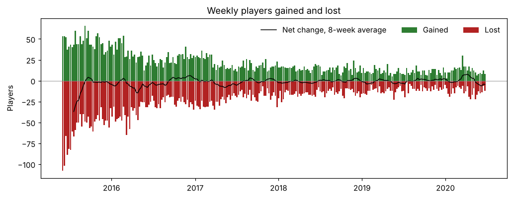
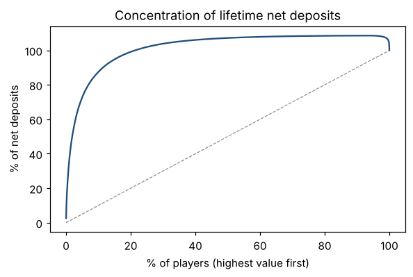
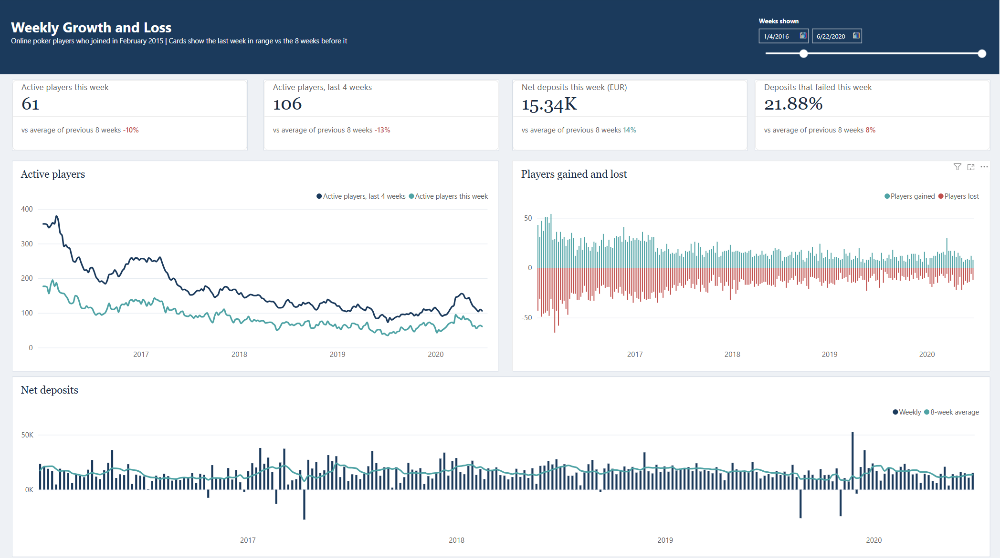
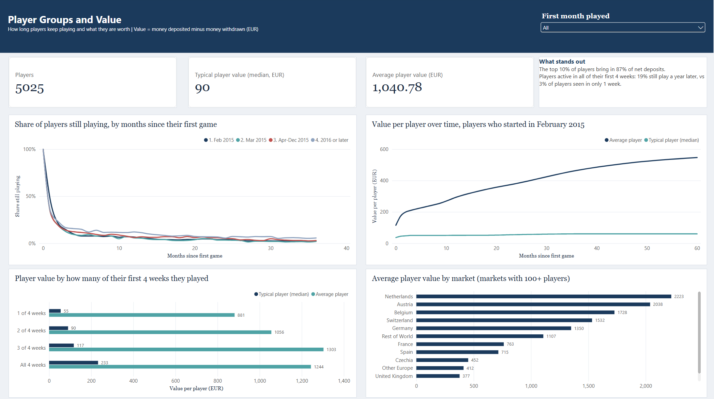
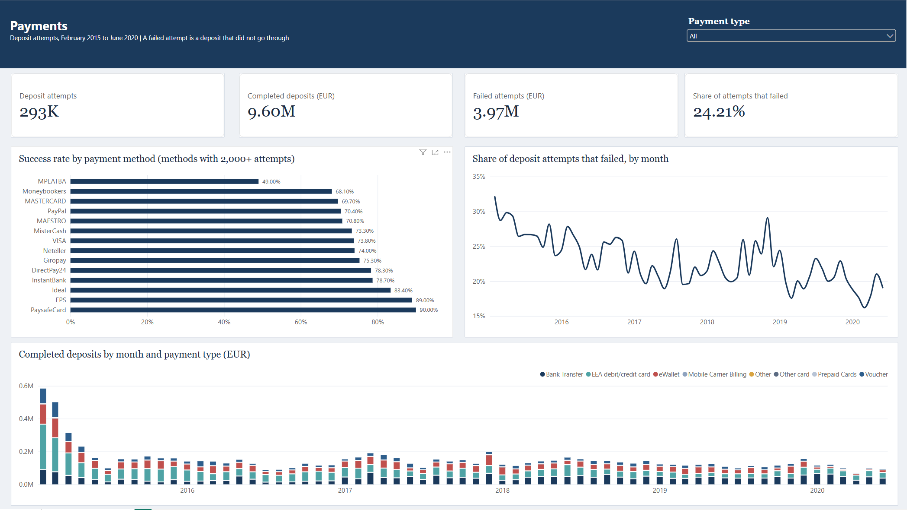
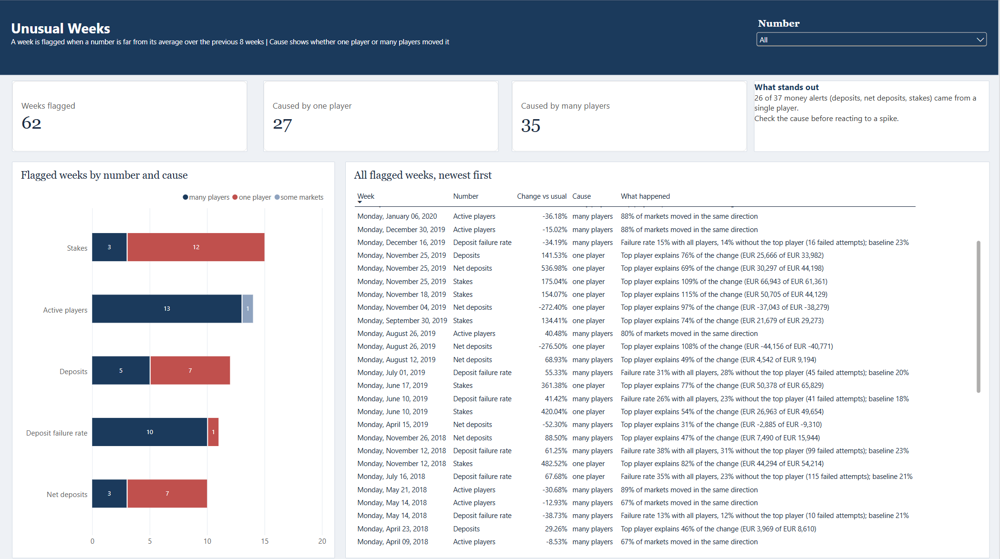

# Online Poker Player Analytics: Growth, Value, Payments and Monitoring

A BI case study on real online poker data: 5,028 players who opened an account in February 2015, with daily poker activity and every deposit and withdrawal through June 2020.

The project answers the questions a BI team brings to leadership each week:

- How many players did we gain and lose, and why did the number move?
- What is a new player worth, and how early can we tell?
- Where do payments fail, and does it cost us players?
- Which unusual weeks need attention, and which are just one player?

**[One-page executive summary](docs/executive_summary.md)**

## Key findings

| Area | Finding |
|---|---|
| Retention | 43% of players who started in February 2015 come back in their second month; about 7% is still playing at month 12. Players active all four of their first weeks are 7x as likely to still be playing a year later. |
| Value | The top 10% of players bring in 87% of net deposits. Median player EUR 90, mean EUR 1,041. |
| Lost players | A player counts as lost after 4 weeks without playing. 9,899 losses and 5,007 returns: about one lost player in two came back. |
| Payments | 24% of deposit attempts fail. Visa, PayPal and Mastercard (56% of attempts) succeed 70-74% of the time. Failures delay deposits but did not make players more likely to leave. |
| Monitoring | 26 of 37 money alerts were caused by a single player. The 2020 lockdown lifted activity in every market while deposits fell 40%. |

## Notebooks

| # | Notebook | What it does |
|---|---|---|
| 01 | [Data audit](notebooks/01_data_audit.ipynb) | Load the raw files, compare with the codebook, list every data issue |
| 02 | [Data model](notebooks/02_data_model.ipynb) | Clean tables by player-day, player-week and player; every total checked back to the raw files |
| 03 | [Metric definitions](notebooks/03_metric_definitions.ipynb) | Decide from the data when a player counts as lost; check that the weekly player balance (last week + new + returning - lost) adds up every week |
| 04 | [Weekly growth and loss](notebooks/04_weekly_growth_loss.ipynb) | Weekly leadership report with an automatic two-sentence summary |
| 05 | [Cohorts and LTV](notebooks/05_cohorts_ltv.ipynb) | How long players stay, what they are worth over time, early signs of valuable players, markets, break-even acquisition cost |
| 06 | [Payments](notebooks/06_payments.ipynb) | Failure rates by method and amount, recovery after failure, withdrawal reversals |
| 07 | [Monitoring](notebooks/07_monitoring.ipynb) | Flag unusual weeks and explain each one: one player or many players |

Definitions are in the [metric dictionary](docs/metric_dictionary.md); data checks are in the [data audit](docs/data_audit.md).

## Power BI report

Four interactive pages built on the outputs of the notebooks. Every page has a filter in the top right; the Weekly page also has a date range slider, and the cards on it compare the last week in range with the 8 weeks before it.

**1. Weekly Growth and Loss.** Active players, players gained and lost, and net deposits each week.

**2. Player Groups and Value.** How long players keep playing and what they are worth, by first month played, early engagement and market.

**3. Payments.** Success rate by payment method, failure rate by month, and completed deposits by payment type.

**4. Unusual Weeks.** Every flagged week with its cause: one player, many players or some markets.

DAX measures: [dashboards/all_measures.dax](dashboards/all_measures.dax). The `.pbix` file is not included because it contains player-level data.

## Tools

SQL (SQLite), Python (pandas, matplotlib), Power BI.

## How to run

1. Download *Second Session at the Virtual Poker Table* from [The Transparency Project](http://www.thetransparencyproject.org/Availabledataset) (accept the terms of use) and put the five CSV files in `data/raw/`.
2. `pip install pandas matplotlib jupyter`
3. Run the notebooks in order from the `notebooks/` folder. Notebook 01 creates `data/poker.db`; the rest read from it.

Raw data and player-level extracts are not included in this repository.

## Limitations

- **No rake or fee data.** Player value is measured as net deposits (money deposited minus money withdrawn, completed transactions only). This is an upper bound on operator revenue: it also includes money lost to other players, spending on other products in the same account, and balances not yet withdrawn.
- **One group of players.** All players opened an account in February 2015; they are grouped by the month they first played poker.
- **Post-2017 completeness is undocumented.** The original study covered February 2015 to January 2017; later data is continuous and treated as complete.

## Data and acknowledgement

Division on Addiction, *Second Session at the Virtual Poker Table*. Medford, MA: Division on Addiction, The Transparency Project [database distributor], accessed October 21, 2026.

This project utilized data from the Transparency Project (www.thetransparencyproject.org), Division on Addiction, the Cambridge Health Alliance, a teaching affiliate of Harvard Medical School.

Related publication: Tom, M. A., Edson, T. C., Louderback, E. R., Nelson, S. E., Amichia, K. A., & LaPlante, D. A. (2022). *Journal of Gambling Studies*. doi:10.1007/s10899-022-10147-1
